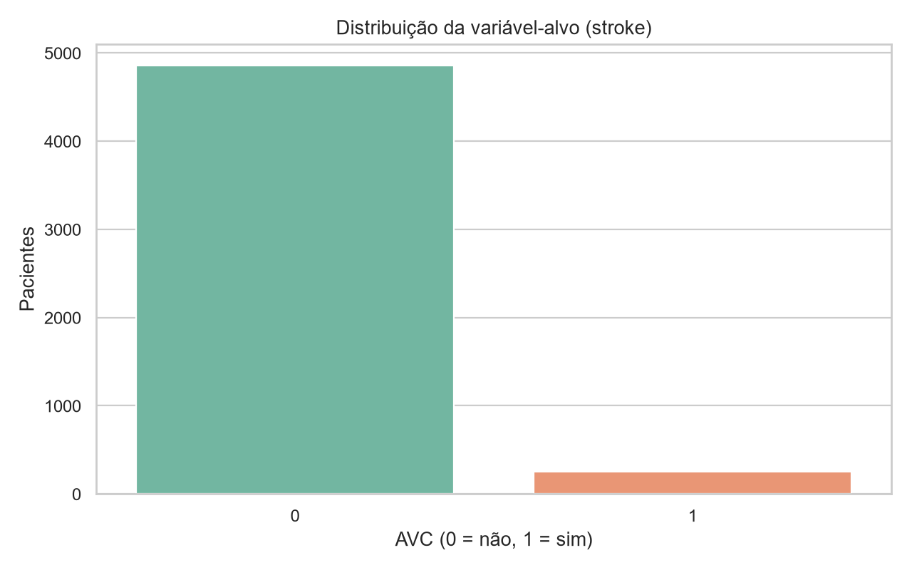
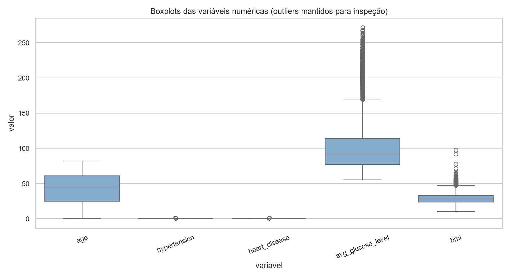
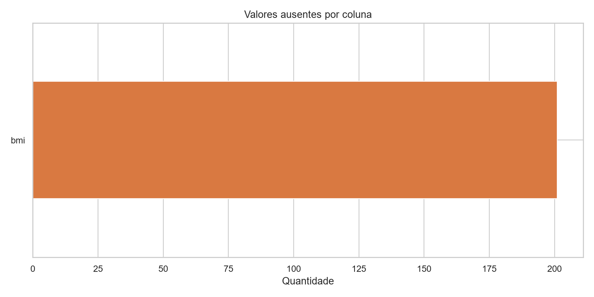
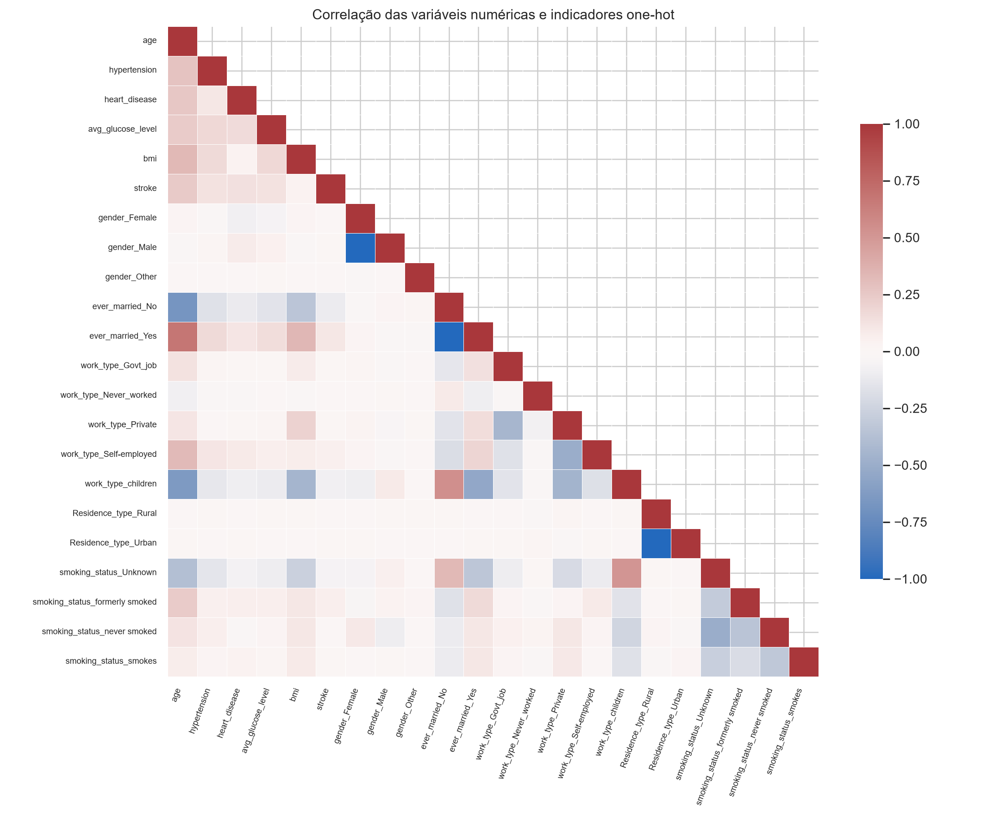
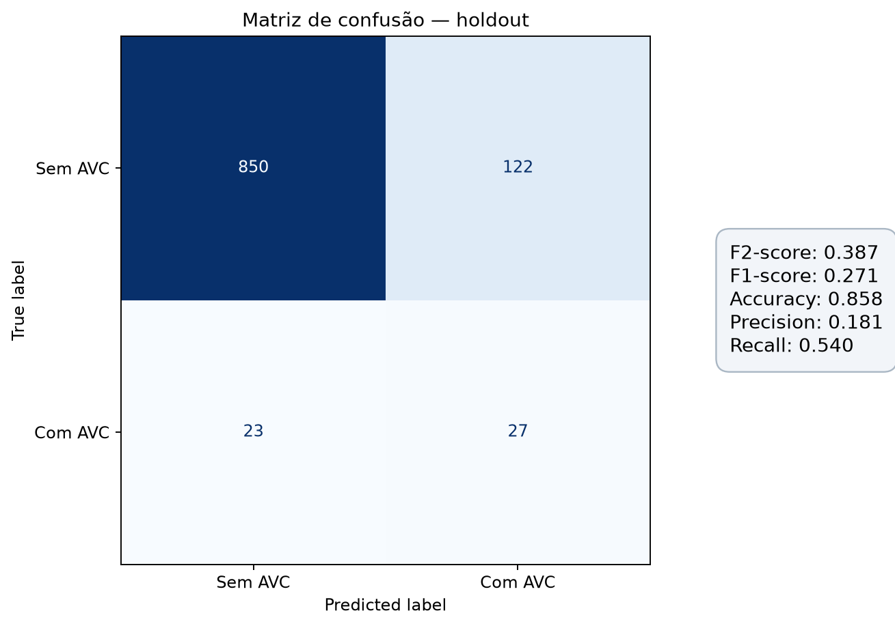
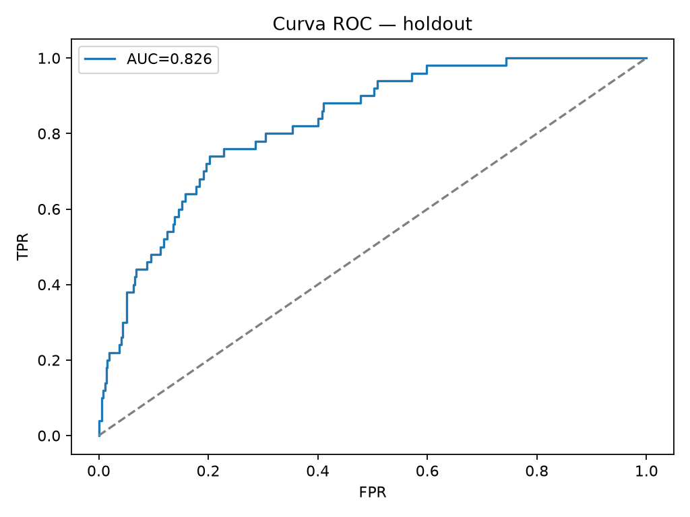
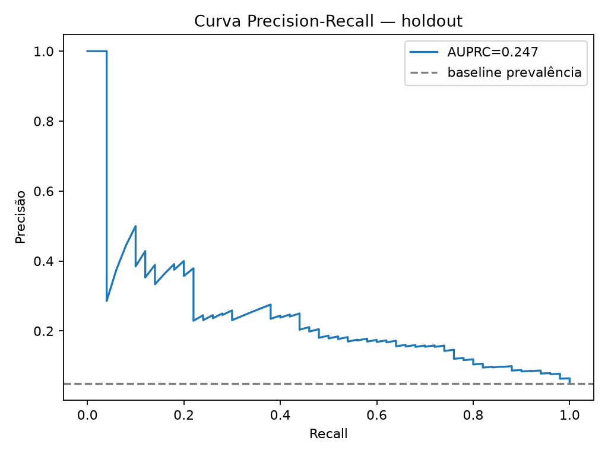

# Predição de AVC

Projeto educacional de classificação binária para estimar a probabilidade de `stroke` a partir dos atributos clínicos e demográficos do conjunto fornecido. A estrutura separa análise, treinamento, serving e artefatos para facilitar manutenção e evolução.

> **Limite de uso:** este protótipo não é dispositivo médico, não foi validado para uso clínico e não deve orientar diagnóstico ou tratamento. O conjunto de dados é pequeno, antigo e possui limitações de representatividade. A probabilidade do modelo não equivale a risco clínico calibrado.

## Estrutura

```text
.
├── config/
│   ├── __init__.py
│   ├── models_config.py    # hiperparâmetros RF, XGBoost e LightGBM
│   ├── paths_config.py     # caminhos de dados, modelos, relatórios e logs
│   └── training_config.py  # seed, holdout, folds e threshold
├── data/
│   ├── raw/                # dataset original, excluído do controle de versão
│   ├── processed/          # reservado para dados derivados
│   └── README.md           # origem e dicionário/contexto dos dados
├── dashboard/
│   └── app.py              # painel Streamlit lendo o tracking MLflow
├── experiments/
│   └── mlruns/             # banco e artefatos locais (fora do Git)
├── logs/                   # métricas agregadas de inferência
├── models/                 # pipeline joblib e model card (gerados no treino)
├── notebooks/
│   ├── 01_eda.ipynb        # exploração inicial fora do pipeline
│   ├── 02_metricas_modelos.ipynb # métricas e matriz de confusão
│   ├── 03_galeria_graficos.ipynb # figuras de EDA e avaliação
│   ├── 04_busca_threshold_recall.ipynb # threshold candidato para recall-alvo
│   └── 05_busca_threshold_accuracy_precision_f1.ipynb # thresholds do pipeline selecionado
├── reports/
│   ├── figures/            # gráficos de EDA e avaliação
│   ├── ROADMAP.md          # próximos passos para operação e painel
│   └── ...                 # métricas e relatórios gerados
├── src/
│   ├── api.py              # endpoints FastAPI
│   ├── eda.py              # EDA e gráficos exploratórios
│   ├── data/               # loader, preprocessing e balancing
│   ├── features/           # separação de atributos e target
│   ├── models/             # treino, avaliação, threshold e registry
│   └── monitoring/         # hook de métricas agregadas para o painel
├── main.py                 # entrada do servidor ASGI
└── requirements.txt
```

## Preparação do ambiente

Recomendado: Python 3.10–3.12 em ambiente virtual.

```bash
python -m venv .venv
# Windows PowerShell: .venv\Scripts\Activate.ps1
# Linux/macOS: source .venv/bin/activate
pip install -r requirements.txt
```

## EDA

```bash
python -m src.eda
```

A análise relata quantidade de linhas/colunas, nulos por coluna, duplicados e prevalência do alvo em `reports/eda_summary.json`; exporta valores ausentes e correlação em CSV e salva figuras em `reports/figures/`. A matriz de correlação usa colunas numéricas e indicadores one-hot, evitando impor uma ordem artificial às categorias nominais. Colunas categóricas são codificadas numericamente para o modelo. No pipeline, imputação e codificação ordinal são ajustadas dentro de cada fold; o SMOTENC recebe os índices categóricos para não interpolar categorias nominais. `id` é identificador e fica fora do treinamento. `Unknown` em `smoking_status` permanece uma categoria explícita.









Os notebooks também estão disponíveis em `notebooks/`: `01_eda.ipynb` explora os dados, `02_metricas_modelos.ipynb` apresenta as métricas e a matriz de confusão, `03_galeria_graficos.ipynb` reúne as imagens, `04_busca_threshold_recall.ipynb` investiga um threshold candidato para a meta de recall e `05_busca_threshold_accuracy_precision_f1.ipynb` busca thresholds para AVC no pipeline selecionado e apresenta métricas por classe.

## Treinamento e seleção

```bash
python -m src.models.train
# ou python main.py (orquestrador de treinamento)
```

1. Reserva 20% dos dados em um holdout estratificado, usado uma única vez para avaliação final.
2. No conjunto de treino compara Random Forest, XGBoost e LightGBM, além de uma configuração de XGBoost com peso para a classe AVC sem reamostragem.
3. Compara **SMOTENC**, a variante de SMOTE para atributos numéricos e categóricos, com SMOTENC + RandomUnderSampler. O XGBoost ponderado mantém a prevalência real no treino; os métodos de reamostragem permanecem como candidatos e são avaliados em CV. SMOTE clássico interpolaria códigos categóricos e poderia gerar categorias artificiais.
4. Imputação, escala, codificação ordinal, SMOTENC e eventual undersampling vivem no pipeline imbalanced-learn e são ajustados dentro de cada fold da validação estratificada de 5 partes. Assim, observações de validação não participam da criação das amostras sintéticas.
5. Registra **AUPRC** (average precision), ROC AUC, recall, F1 e F2 em CV. A seleção da configuração é pela média **AUPRC em CV**, que mede a qualidade do ranqueamento para a classe rara sem fixar threshold. O threshold operacional segue buscando F2 no OOF para dar mais peso ao recall.
6. Para cada configuração, busca em loop os thresholds das probabilidades out-of-fold e escolhe o que maximiza **F2** (`beta=2`). F2 dá mais peso ao recall e prioriza encontrar pacientes com `stroke=1`, aceitando que isso pode aumentar falsos positivos e reduzir precisão. O threshold é estimado só no treino; o holdout permanece isolado.
7. Reajusta a configuração selecionada em todo o treino, mede no holdout e salva o pipeline completo e threshold em `models/stroke_pipeline.joblib`.

O artefato carrega pré-processamento, sampler e classificador; em predição, o pipeline não reamostra. Resultados por configuração ficam em `reports/model_metrics.json`, metadados da escolha em `models/model_card.json`, matriz gráfica com F2/F1-score, accuracy, precision e recall, e curvas ROC/Precision-Recall em `reports/figures/`.







Os gráficos de avaliação são gerados após treinamento. Consulte também `reports/ROADMAP.md` para a evolução do painel e das salvaguardas operacionais.

## MLflow

O treinamento configura tracking local em `mlflow.db` (SQLite) e cria/usa o experimento `stroke-risk-classification`. Cada combinação de algoritmo e sampler registra parâmetros e métricas; o pipeline escolhido é persistido separadamente por joblib em `models/`. Visualização local:

```bash
mlflow ui --backend-store-uri sqlite:///experiments/mlflow.db
```

Abra `http://127.0.0.1:5000`. Para uma implantação compartilhada, configure tracking server e backend/artifact store persistentes por ambiente; o tracking local é o ponto de partida. Cada nova execução cria uma linha de acompanhamento, mas não há monitor de produção nem ingestão de eventos de inferência ainda.

### Painel inicial

```bash
streamlit run dashboard/app.py
```

O painel atualiza a cada 10 segundos e lê as execuções de treinamento do banco local do MLflow. Ele acompanha estado, parâmetros e métricas por rodada. A API registra apenas timestamp, nome de modelo e classe prevista em `logs/inference_metrics.jsonl`, sem persistir atributos ou probabilidade do paciente. Para monitoramento operacional completo, falta adicionar volume/latência/erros e drift observado com rótulos tardios.

## API

Treine primeiro para gerar o artefato e inicie:

```bash
uvicorn main:app --reload
```

- `GET /health`: disponibilidade e estado do modelo.
- `GET /model`: algoritmo, sampler e threshold ativo.
- `POST /predict`: recebe dados de um paciente e retorna probabilidade, decisão no threshold ativo e algoritmo.
- `GET /docs`: documentação interativa.

Exemplo de corpo:

```json
{
  "gender": "Female", "age": 67, "hypertension": 0, "heart_disease": 1,
  "ever_married": "Yes", "work_type": "Private", "Residence_type": "Urban",
  "avg_glucose_level": 228.69, "bmi": 36.6, "smoking_status": "formerly smoked"
}
```

O endpoint não guarda dados de pacientes. Para um painel em tempo real, a próxima etapa é adicionar autenticação, logging com minimização de dados, contadores agregados sem identificadores pessoais e exportação de métricas para Prometheus/Grafana ou ferramenta equivalente. A estrutura e o endpoint `/health` deixam o serving encaminhado, mas ainda não existe painel nem telemetria de produção.

## Métricas

- **AUPRC / Average Precision:** sumariza a curva precisão-recall; foca na qualidade da classe AVC rara.
- **ROC AUC:** capacidade de ranquear positivos acima de negativos em diferentes thresholds.
- **Precisão:** entre os alertas, parcela que corresponde a positivos.
- **Recall / sensibilidade:** parcela dos positivos identificados.
- **F1:** média harmônica de precisão e recall.
- **F2:** média harmônica que dá mais peso ao recall; usada para estimar threshold para focar na classe AVC positiva.
- **Acurácia:** proporção de acertos; reportada, mas pouco representativa diante do forte desbalanceamento.

### Resultado desta execução

Dados: 5.110 linhas, 249 positivos (4,87%), 201 valores ausentes (todos em `bmi`) e 0 linhas duplicadas. Com split estratificado 80/20 e seed 42, a seleção por AUPRC média em CV escolheu XGBoost ponderado, sem reamostragem e com encoding ordinal. SMOTENC e SMOTENC + undersampling continuam avaliados como candidatos; nesta execução, não melhoraram o ranking médio em CV.

| Modelo | Amostragem | CV AUPRC média ± DP | CV F2 média | Holdout AUPRC | Holdout Recall |
|---|---|---:|---:|---:|---:|
| XGBoost ponderado | Nenhuma (encoding ordinal) | 0,207 ± 0,054 | 0,394 | 0,258 | 0,780 |
| XGBoost ponderado | Nenhuma (one-hot) | 0,205 ± 0,050 | 0,393 | 0,244 | 0,760 |
| XGBoost | SMOTENC + undersampling | 0,148 ± 0,013 | 0,364 | 0,249 | 0,680 |
| XGBoost | SMOTENC | 0,153 ± 0,021 | 0,350 | 0,232 | 0,720 |
| Random Forest | SMOTENC + undersampling | 0,143 ± 0,013 | 0,271 | 0,185 | 0,800 |
| LightGBM | SMOTENC + undersampling | 0,137 ± 0,014 | 0,237 | 0,183 | 0,780 |
| LightGBM | SMOTENC | 0,155 ± 0,032 | 0,224 | 0,191 | 0,680 |
| Random Forest | SMOTENC | 0,137 ± 0,013 | 0,202 | 0,171 | 0,840 |

O artefato selecionado é **XGBoost ponderado**, com `scale_pos_weight` calculado pela proporção de classes no treino; não aplica SMOTE/RUS. O encoding ordinal converte categorias em números; a variante one-hot também foi comparada e ficou ligeiramente abaixo em AUPRC CV. O threshold salvo maximiza F2 OOF (**0,3958**) para preservar a prioridade de recall: no holdout, AUPRC **0,258**, ROC-AUC **0,842**, recall **0,780**, precision **0,132**, F1 **0,226** e accuracy **0,739**; matriz `[[716, 256], [11, 39]]`. O notebook 05 também mostra que o threshold de melhor F1 OOF (**0,6165**) elevou no holdout precision para **0,225** e F1 para **0,333**, com recall **0,640**. Assim, há um tradeoff operacional entre precisão e casos detectados. O ranking melhorou modestamente contra SMOTENC + RUS (AUPRC CV 0,148; holdout 0,249). Como o holdout já foi consultado em iterações exploratórias, esses números não são uma estimativa final independente; ainda é necessária validação externa.

## Limitações e próximos passos

- Validar com dados externos, atuais e representativos; analisar calibração e desempenho por subgrupos.
- Definir threshold com profissionais e custos explícitos de decisão; maximizar F2 favorece recall, mas pode gerar mais falsos positivos.
- Persistir tracking em serviço apropriado e instrumentar métricas de tráfego, latência, falhas e drift sem registrar dados identificáveis.
- Implementar controles de acesso, privacidade, versionamento, testes e processo documentado de aprovação antes de qualquer uso real.

Veja [reports/ROADMAP.md](reports/ROADMAP.md) para o plano resumido.
